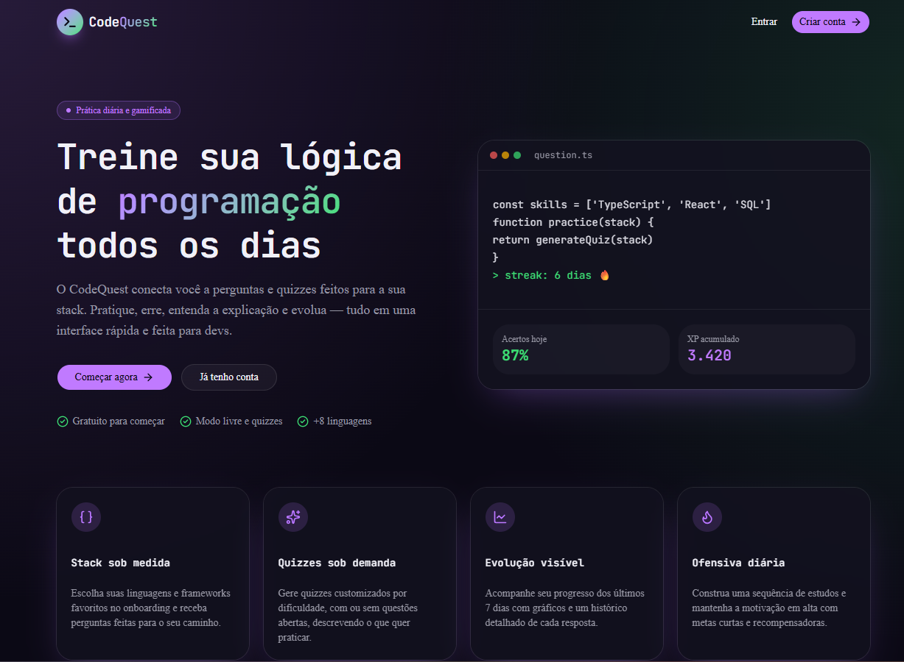

# CodeQuest

Plataforma de prática de programação gamificada: responda perguntas no modo livre ou em quizzes customizados, acompanhe seu histórico e evolução.



## Getting Started

First, run the development server:

```bash
npm run dev
# or
yarn dev
# or
pnpm dev
# or
bun dev
```

Open [http://localhost:3000](http://localhost:3000) with your browser to see the result.

## Stack

- [Next.js](https://nextjs.org) (App Router)
- TypeScript
- Tailwind CSS
- Shadcn
- Motion
- Recharts
- ESLint
